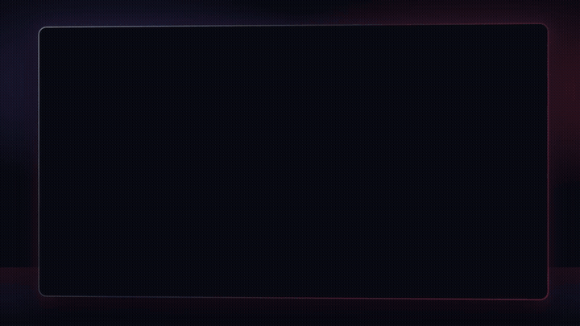

# Stealth Prompter

[](LICENSE)
[](https://www.rust-lang.org/)
[](https://v2.tauri.app/)
[](https://learn.microsoft.com/en-us/windows/win32/api/winuser/nf-winuser-setwindowdisplayaffinity)
[](https://github.com/stealthprompter/stealthprompter/releases)
[](https://github.com/stealthprompter/stealthprompter)

> **The open-source invisible teleprompter that stays hidden from screen sharing and recordings.**  
> Built with **Tauri 2**, **Rust**, and **SolidJS**. Engineered for zero latency, minimal memory usage, and true OS-level screen capture exclusion on Windows.

<p align="center">
  
</p>

---

## Table of Contents
- [Core Value Proposition](#core-value-proposition)
- [Features](#features)
- [Invisibility & Technical Deep Dive](#invisibility)
- [Comparison vs Alternatives](#comparison-vs-alternatives)
- [Architecture](#architecture)
- [Keyboard Shortcuts](#keyboard-shortcuts)
- [Verification & Testing](#verification--testing)
- [Installation & Quick Start](#installation)
- [Directory Layout](#directory-layout)
- [Clean-Room Engineering & Ethics](#clean-room-engineering--ethics)
- [License](#license)

---

## Core Value Proposition

Modern presentations, technical demos, and video conferences demand flawless delivery while maintaining natural eye contact with your camera. Traditional teleprompter workflows fall short:
1. **Intrusive Screen Overlays**: Generic prompters clutter your display and leak onto screen shares, exposing your script to your audience.
2. **Heavy Electron Runtimes**: Commercial tools like FlowPrompter package full Chromium and Node.js instances, consuming **180–300 MB of RAM**, triggering garbage collection pauses, and eating 10–18% CPU during high-refresh-rate scrolling.
3. **Fragile Invisibility Hacks**: Black-box overlays, virtual camera gymnastics, or complex chroma-key filters add friction and often fail during urgent screen shares.
4. **Proprietary Lock-in & Telemetry**: Monthly subscription paywalls for basic features and constant cloud telemetry.

**Stealth Prompter solves this permanently:**
- **Native OS-Level Invisibility**: Leverages the Windows Desktop Window Manager (DWM) display affinity API (`WDA_EXCLUDEFROMCAPTURE = 0x00000011` / 17) to completely eliminate the teleprompter window from screen captures, desktop shares, and recording streams.
- **Blazing Performance**: Native Rust core + SolidJS fine-grained reactivity uses **under 40 MB of RAM** and **<2% CPU** during active 144Hz scrolling.
- **Non-Focus-Stealing Operation**: Control your script while remaining actively focused on PowerPoint, VS Code, or a terminal.
- **100% Open Source & Offline-First**: Clean-room engineered under the MIT License with zero telemetry and zero external dependencies.

---

## Features

- 🛡️ **True DWM Capture Invisibility**: Window surface is omitted by the OS compositor before frames reach screen capture APIs.
- ⚡ **Ultra-Lightweight & Fast**: Rust backend and SolidJS UI compile to a lean `<15 MB` installer using Microsoft Edge WebView2.
- 🎯 **Non-Focus-Stealing Hotkeys**: Global shortcuts (`Alt+Space`, `Alt+Up/Down`, `Alt+H`) control playback without losing focus from your foreground presentation.
- 🪟 **Multi-Window Dark Glass UI**:
  - **Launcher (`index.html`)**: Dark glass control hub for managing scripts, adjusting playback speeds, and editing hotkeys.
  - **Prompter HUD (`hud.html`)**: Transparent, frameless, topmost overlay displaying smoothly scrolling text.
- 📜 **144Hz Hardware-Accelerated Auto-Scroll**: Butter-smooth CSS GPU transforms without Virtual DOM reconciliation micro-stutters.
- 🔄 **Mirror Mode**: Horizontal flip mode for use with beam-splitter teleprompter glass hardware.
- 🖱️ **Click-Through Toggle**: Pass mouse clicks directly through the prompter overlay to manipulate windows underneath.
- 💾 **Atomic Local Persistence**: Transactional `.tmp` file write and atomic rename ensures zero data loss for `settings.json` and scripts.
- 🔒 **Zero Telemetry & Offline-First**: Operates strictly on your local machine; never makes external network calls.

---

## Invisibility

### How Windows DWM Invisibility Works
Stealth achieves invisibility by directly invoking the Win32 API:

```rust
SetWindowDisplayAffinity(hwnd, WDA_EXCLUDEFROMCAPTURE);
```

#### The Science of `WDA_EXCLUDEFROMCAPTURE` (0x00000011 / 17)
- **Introduction**: Introduced in **Windows 10 Version 2004 (Build 19041)** and natively standard in **Windows 11**.
- **Difference from Legacy `WDA_MONITOR` (`0x00000001`)**:
  - Legacy `WDA_MONITOR` masked protected windows by rendering a solid black rectangle in screen captures. While this prevented sensitive content leaks, it was visibly noticeable to meeting attendees.
  - `WDA_EXCLUDEFROMCAPTURE` instructs the Desktop Window Manager (DWM) composition pipeline to **completely exclude the window surface** when assembling frames for screen capture APIs. DWM renders whatever window or wallpaper lies directly behind the prompter, rendering it 100% transparent and invisible to the capture engine.
- **Supported Capture Pipelines**:
  - **DirectX Graphics Infrastructure (DXGI)** Desktop Duplication
  - **Windows Graphics Capture (WGC)** API
  - **GDI Screen Scraping** (`BitBlt` / `GetDC`)
  - **DirectShow / MediaFoundation** screen capture filters
- **Compatibility Matrix**:
  - ✅ **Zoom** (Full Desktop & Window Sharing)
  - ✅ **Microsoft Teams** (Screen & Window Sharing)
  - ✅ **Google Meet** (Screen Sharing via Chrome / Edge)
  - ✅ **OBS Studio** (Display Capture / Desktop Duplication Source)
  - ✅ **Discord** (Screen Share / Stream)
  - ✅ **Slack, Webex, Loom, Camtasia**

> **Note on OS Compatibility**: If executed on a Windows build earlier than 19041, Stealth's `WindowsPlatform` automatically detects the OS build via `RtlGetVersion` and provides a controlled fallback to `WDA_MONITOR` with explicit logging.

---

## Comparison vs Alternatives

| Technical Metric | Stealth Prompter | FlowPrompter Desktop | Generic Teleprompters |
|---|---|---|---|
| **Core Architecture** | **Tauri 2 + Rust + SolidJS** | Electron + React (Node.js) | Electron / Web / Python |
| **Idle RAM Footprint** | **25 – 45 MB** | 180 – 280 MB | 150 – 250 MB |
| **Active Scroll RAM** | **50 – 70 MB** | 250 – 380 MB | 200 – 350 MB |
| **Active Scroll CPU** | **< 2% CPU** | 8% – 18% CPU | 5% – 15% CPU |
| **Installer Size** | **~8 – 15 MB** | 85 – 120 MB | 60 – 100 MB |
| **Installed Disk Space** | **~25 MB** | 220 – 350 MB | 150 – 300 MB |
| **Cold Boot Startup Time** | **< 350 ms** | 1,800 – 3,500 ms | 1,500 – 3,000 ms |
| **Invisibility Mechanism** | **Native Win32 DWM (`0x11`)** | Native Win32 C++ addon | None / Virtual Cam / Window Hacks |
| **Capture Exclusion Visual** | **100% Invisible (Pass-through)** | 100% Invisible | Black Box or Visible |
| **Focus Retention** | **Zero Focus Stealing (`SW_SHOWNOACTIVATE`)** | Prone to focus clash | Often steals keyboard focus |
| **Render Engine Overhead** | **Zero VDOM (Direct DOM transforms)** | Virtual DOM diffing & GC | High DOM re-renders |
| **Open Source License** | **MIT (100% Free & Open Source)** | Proprietary ($49 – $99/yr) | Proprietary / Ad-supported |
| **Telemetry & Tracking** | **Zero (Strictly Offline-First)** | Analytics & license servers | Cloud tracking |

---

## Architecture

Stealth Prompter employs a strictly decoupled, modular architecture adhering to clean-room engineering:

```
┌─────────────────────────────────────────────────────────────┐
│                 Desktop Window Manager (DWM)                │
└──────────────────────────────▲──────────────────────────────┘
                               │ SetWindowDisplayAffinity(0x11)
┌──────────────────────────────┴──────────────────────────────┐
│                    WindowPlatform Trait                     │
│  - set_display_affinity()    - set_click_through()          │
│  - set_no_activate()         - show_unfocused() / hide()    │
├──────────────────────────────┬──────────────────────────────┤
│  WindowsPlatform (Win32 API) │  MockPlatform (Headless CI)  │
└──────────────────────────────┴──────────────────────────────┘
                               │
┌──────────────────────────────┴──────────────────────────────┐
│                   Tauri 2 Core Backend                      │
│  - commands/ (IPC Handlers)   - storage/ (Atomic JSON)      │
│  - shortcuts/ (Global Hooks) - state/ (Thread-Safe Store)   │
└──────────────────────────────▲──────────────────────────────┘
                               │ Inter-Window IPC / Events
        ┌──────────────────────┴──────────────────────┐
        ▼                                             ▼
┌─────────────────────────────┐ ┌─────────────────────────────┐
│   Launcher (index.html)     │ │     Prompter (hud.html)     │
│  - Script Editor & Library  │ │  - Frameless Topmost Overlay│
│  - Settings & Hotkeys Config│ │  - 144Hz GPU Smooth Scroll  │
│  - Dark Glass Aesthetics    │ │  - Mirror & Click-Through   │
└─────────────────────────────┘ └─────────────────────────────┘
```

### 1. The `WindowPlatform` Trait (`src-tauri/src/platform/mod.rs`)
Decouples operating system specifics from business logic:
- `WindowsPlatform`: Uses `windows-rs` (0.58) to invoke Win32 APIs directly (`SetWindowDisplayAffinity`, `SetWindowLongPtrW`, `ShowWindow`, `DwmSetWindowAttribute`).
- `MockWindowPlatform`: In-memory thread-safe state mock enabling automated E2E and unit testing in headless CI environments without requiring a Win32 display server.

### 2. Multi-Window Design (`src-tauri/tauri.conf.json`)
Configures two distinct WebViews:
- `launcher`: Resizable, decorated dark glass window (`800x600`) for script authoring.
- `prompter`: Transparent, frameless, topmost window (`900x350`) set with `alwaysOnTop: true`, `skipTaskbar: true`, and `decorations: false`.

### 3. Inter-Window Event Bus
Synchronizes playback state and content seamlessly:
- `prompter:action`: Dispatches play, pause, rewind, reset, and speed adjustments.
- `prompter:update_script`: Pushes updated script content to the HUD.
- `prompter:state_sync`: Emits current playback status, velocity, and scroll percentage.

### 4. Atomic JSON Persistence (`src-tauri/src/storage/engine.rs`)
Ensures corruption-proof storage in `%APPDATA%\com.stealth.desktop\`:
- Writes new state to a randomized temporary file (`.tmp`).
- Flushes buffers to disk with `sync_all()`.
- Atomically replaces the target file via filesystem `rename()`.

---

## Keyboard Shortcuts

Stealth intercepts hotkeys globally using `tauri-plugin-global-shortcut`. Commands execute immediately without transferring window focus away from your active presentation:

| Shortcut | Action | Scope | Focus Retained? |
|---|---|---|---|
| `Alt + Space` | Toggle Play / Pause | System-wide Global | Yes (Active app stays focused) |
| `Alt + Up` | Increase Speed (+1.0) | System-wide Global | Yes (Active app stays focused) |
| `Alt + Down` | Decrease Speed (-1.0) | System-wide Global | Yes (Active app stays focused) |
| `Alt + H` | Toggle Overlay / Panic Hide | System-wide Global | Yes (Active app stays focused) |
| `Alt + R` | Rewind / Reset to Beginning | HUD / Launcher | Yes |
| `Alt + M` | Toggle Mirror Mode (Flip Horizontal) | Prompter HUD | Yes |
| `Alt + C` | Toggle Click-Through Mode | Prompter HUD | Yes |
| `Ctrl + +` | Increase Font Size | Launcher / HUD | Yes |
| `Ctrl + -` | Decrease Font Size | Launcher / HUD | Yes |

*Note: All shortcuts can be customized in the Launcher Settings panel.*

---

## Verification & Testing

Stealth Prompter includes automated verification tools and manual testing checklists.

### Automated Invisibility Canary Probe
The automated test probe (`scripts/verify_invisibility.ps1`) verifies exclusion at the raw pixel level:
1. Opens an overlay window filled with solid high-contrast Magenta (`#FF00FF`).
2. Applies `WDA_EXCLUDEFROMCAPTURE` (17) via `WindowsPlatform`.
3. Triggers a desktop screen capture using the DXGI Desktop Duplication engine or FFmpeg (`gdigrab`).
4. Scans the captured image buffer for any canary pixel matching `#FF00FF`.
5. Passes only if **0 canary pixels** are detected (`canaryPixelsFound === 0`).

### OBS Studio Manual Verification Protocol
Follow these 5 steps to verify invisibility in OBS Studio:
1. **Launch Stealth**: Open the prompter HUD and position it over a colorful or high-contrast desktop background.
2. **Launch OBS Studio**: In your active scene, add a **Display Capture** source targeting your main display.
3. **Inspect OBS Preview**: Verify that the desktop background and wallpaper are rendered, but the prompter text and HUD overlay are **completely absent** from the OBS canvas.
4. **Record Test Video**: Start a 10-second test recording in OBS while speaking and scrolling text in the prompter.
5. **Review Output**: Open the resulting `.mp4` file and confirm the recording is pristine with zero prompter bleed-through.

---

## Installation

### Prerequisites
- **Operating System**: Windows 10 Version 2004 (Build 19041) or Windows 11 (64-bit).
- **Rust Toolchain**: `stable-x86_64-pc-windows-msvc` (Rust 1.75+ or 1.100.0).
- **Node.js**: Version 20.x or higher + `pnpm` (8+ or 12+).
- **C++ Build Tools**: Visual Studio 2022 C++ Build Tools (`vcredist140`).
- **WebView2 Runtime**: Pre-installed on Windows 10/11 (or installed via evergreen bootstrapper).

### Clone & Install Dependencies
```bash
git clone https://github.com/stealthprompter/stealthprompter.git
cd stealthprompter
pnpm install
```

### Running in Development
```bash
pnpm tauri dev
```
This spins up the Vite development server for both the `launcher` and `hud` multi-page frontends and compiles the Rust backend with hot-reload enabled.

### Building for Release
```bash
pnpm tauri build
```
The optimized binaries and installers will be generated under:
- `src-tauri/target/release/stealth.exe` (Standalone executable)
- `src-tauri/target/release/bundle/nsis/` (`.exe` NSIS Installer)
- `src-tauri/target/release/bundle/msi/` (`.msi` Windows Installer)

---

## Directory Layout

```
g:\Teleprompter\
├── .github\
│   ├── ISSUE_TEMPLATE\          # Bug report and feature request templates
│   └── workflows\
│       └── release.yml          # Automated CI/CD release pipeline with tauri-action
├── remotion\                    # Remotion 3D Launch Video Package
│   ├── src\
│   │   ├── Composition.tsx      # 1920x1080 30fps 4-scene master sequence
│   │   ├── index.ts             # Remotion entry point
│   │   └── scenes\              # 4 deterministic 3D scenes (Three.js)
│   ├── package.json             # Remotion, @remotion/three, Three.js dependencies
│   └── remotion.config.ts       # Video rendering and Chromium WebGL flags
├── scripts\
│   ├── benchmark_resources.ps1  # Automated RAM, CPU, and binary size benchmarks
│   └── verify_invisibility.ps1  # Automated #FF00FF canary probe capture test
├── src\                         # SolidJS Frontend (Vite Multi-Page App)
│   ├── components\              # Reusable glassmorphic UI widgets
│   ├── hud\                     # Transparent HUD overlay app (hud.html)
│   ├── launcher\                # Dark glass management launcher (index.html)
│   └── lib\                     # Tauri IPC event bus and client wrappers
├── src-tauri\                   # Native Rust Backend (Tauri 2)
│   ├── capabilities\            # Security sandbox permissions
│   ├── src\
│   │   ├── commands\            # Tauri IPC command implementations
│   │   ├── platform\            # WindowPlatform trait, Win32 & mock engines
│   │   ├── shortcuts\           # Non-focus-stealing global hotkeys
│   │   ├── storage\             # Atomic JSON persistence (settings & scripts)
│   │   ├── lib.rs               # Library bootstrap and re-exports
│   │   └── main.rs              # Application entry point
│   ├── Cargo.toml               # Rust dependencies (tauri, windows, serde)
│   └── tauri.conf.json          # Multi-window and security capabilities config
├── tests\                       # E2E Test Suite (Tiers 1-4, 240+ assertions)
├── vault\                       # Clean-Room Engineering Obsidian Vault
│   ├── 00-Index.md              # Master vault navigation map
│   ├── Log.md                   # Chronological engineering log
│   ├── 01-Analisis\             # Clean-room functional reverse-engineering
│   ├── 02-Naming\               # Brand research & availability evidence
│   ├── 03-Arquitectura\         # Architecture Decision Records (ADRs)
│   ├── 04-Diseno\               # Glassmorphism design tokens & UX specs
│   ├── 05-Marketing\            # Marketing copy & launch strategy
│   └── 06-Video\                # 3D video storyboard and scene breakdown
├── LICENSE                      # MIT Open Source License
└── README.md                    # Comprehensive English documentation
```

---

## Clean-Room Engineering & Ethics

Stealth Prompter was built adhering to strict **Clean-Room Software Engineering** principles:
- **Zero Proprietary Code**: No code, assets, styles, or binary blobs were copied from FlowPrompter or any other proprietary teleprompter.
- **Specification-Driven**: Implementation was designed from clean functional requirements and public Microsoft Win32 DWM documentation.
- **Responsible Use**: Stealth Prompter is designed to assist public speakers, educators, content creators, and remote professionals in delivering clear, confident presentations while maintaining natural eye contact.

---

## License

Stealth Prompter is 100% open-source software licensed under the **[MIT License](LICENSE)**.
